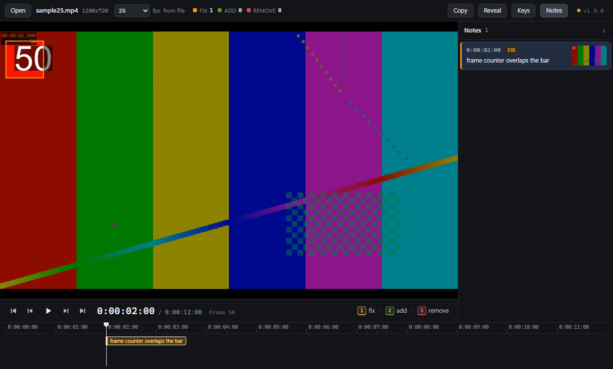

<div align="center">


[](https://github.com/softoblivion/retake/releases/latest/download/Retake.exe)
[](https://github.com/softoblivion/retake/releases/latest)


[](LICENSE)

**Frame-accurate video review notes for editors and reviewers on Windows. Pause on a frame, press 1, 2 or 3, mark the element and type a line: every note lands on the exact frame with an After Effects style timecode, in a notes folder next to the render. Drag notes along the timeline, add general notes for the whole video, and pack the review into one zip to send. Plays H.264, HEVC, ProRes, DNxHD, VP9 and AV1 through the mpv engine with exact frame stepping. One portable exe, no installer, no account; updates itself from GitHub Releases.**



<sub>Pause on a frame · press 1, 2 or 3 and mark the element · type the note.</sub>

</div>

---

## Why Retake

- **Three keys, no mouse.** `1` fix, `2` add, `3` remove. The video pauses, the note takes the current frame, you
  type one line and press `Enter`.
- **Point at the thing.** Drag a rectangle around the element on the frame, or click to put a point. The note gets
  a PNG of that frame at full size with the mark drawn on it, so "this title" needs no description.
- **Exact frames on real deliverables.** Mezzanine and long-GOP renders open as they are, and every seek, step and
  note lands on the exact frame, also at drop-frame rates and on files whose video starts late.
- **Timecodes the editor can use.** `0:00:12:07` as in the After Effects timeline (drop-frame `0;00;12;07` for
  29.97 and 59.94), computed from the file's real frame rate.
- **One folder next to the video.** `promo_v3.mp4` gets `promo_v3_notes\` with the notes as a plain text file and
  the frame images. **Done** packs both into one zip, and the notes copy as plain text that reads the same in any
  chat.
- **Free, open source, portable.** GPL-3.0, one exe with a data folder next to it. No account, no telemetry; videos
  and notes never leave the machine.

## Quick start

1. Download [`Retake.exe`](https://github.com/softoblivion/retake/releases/latest/download/Retake.exe) into a folder
   of its own, for example `D:\Apps\Retake\`.
2. Run it and drop a video onto the window (or press `Ctrl+O`, or use "Open with" in Explorer).
3. Play, pause on a frame, press `1`, `2` or `3`, drag a rectangle around the element if it helps, type the note,
   press `Enter`. The notes are saved after every change.

**Requirements:** Windows 10 or 11, 64-bit. The video engine is inside the exe; no codec packs, no installer, no
admin rights.

> [!NOTE]
> The executable is not code-signed, so Windows SmartScreen may warn on first start (**More info → Run anyway**).

## Features

| | |
|---|---|
| **Built-in engine** | Containers MP4, MOV, MKV and WebM, decoded by mpv inside the exe with hardware decoding where the GPU has it; no codec packs or Windows extensions. |
| **Shuttle and stepping** | Arrow keys step one frame, `Shift` ten, `J` / `K` / `L` shuttle up to 8x; dragging in the ruler scrubs. The [full key map](docs/USER_GUIDE.md#keyboard) is one `?` away. |
| **Frame rate** | Read from the file and checked against the player; a wrong or missing rate is overridden per video, and the timecodes of its notes follow. |
| **Mini timeline** | Ruler with timecodes, playhead and one tagged marker per note; resting on a tag shows the note and its frame image, a drag moves the note to another frame, the wheel zooms. |
| **Notes list** | General notes for the whole video first, then every frame note with its thumbnail; `↑` / `↓` move through them, `F2` edits, `Delete` removes. |
| **Right-click menus** | Notes, the video, the timeline and the list offer their actions with the key of each, so nobody has to learn the keys first. |
| **Send the review** | **Done** packs the notes and their frame images into one zip; `Ctrl+Shift+C` copies the notes as plain text for a chat; a click on any timecode copies it for the time field of After Effects or Premiere. |
| **Full screen** | `F11` or a double click on the video gives the whole monitor to the review. |
| **Recent videos** | The start screen lists recent videos with their note counts and opens them at the frame they were left on. |
| **Glass look** | Crystal Black and Crystal Sky themes and a Scale setting from 100 to 200 % for the whole window. |
| **Self-updating** | New releases are found in the background, downloaded, verified by size and SHA-256 and installed on **Restart to update**. |

## Documentation

| Document | What it covers |
|---|---|
| [User guide](docs/USER_GUIDE.md) | Install, usage, keyboard, settings, the notes file, timecodes, supported video, data folder, updates, FAQ |
| [Build](docs/BUILD.md) | Prerequisites, the build script, libmpv, tests, end-to-end update tests, releasing |
| [Release notes](docs/releases/) | What changed in every version |
| [Third-party components](docs/THIRD_PARTY.md) | What is bundled into the exe, with licences and sources |

## Building from source

Requirements: Windows, the .NET 8 SDK, the .NET Framework 4.8 Developer Pack, PowerShell 5.1, Git; 7-Zip on the
first build (it unpacks the pinned libmpv).

```powershell
git clone https://github.com/softoblivion/retake.git
cd retake
powershell -ExecutionPolicy Bypass -File build\build.ps1
```

The script checks the tree, fetches and verifies the pinned libmpv, runs the tests and produces
`release\Retake.exe` with `release\SHA256SUMS`.

| Task | Command |
|---|---|
| Run from source | `dotnet build Retake.sln -c Release`, then `src\Retake\bin\Release\Retake.exe [video]` |
| Unit tests | `set RETAKE_HOME=%TEMP%\retake-tests` then `tests\Retake.Tests\bin\Release\Retake.Tests.exe` |
| Control gallery | `src\Retake\bin\Release\Retake.exe --gallery [--theme sky] [--scale 150]` |

## Disclaimer

After Effects and Premiere Pro are trademarks of Adobe. Retake is an independent tool, not affiliated with Adobe; it
only writes timecodes in the form those applications display.

## License

Released under the [GNU General Public License v3.0](LICENSE). Any distributed copy or derivative work must stay
open source under the same license and keep the copyright notices.
